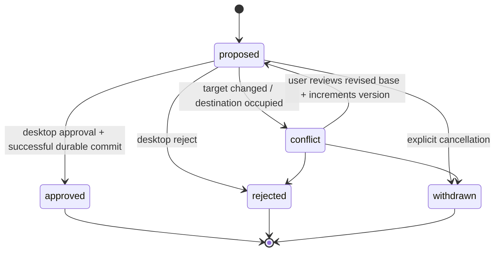

# Personal Brain — Data Schema & Persistence Contract

Version 0.1.0 | Proposed baseline | PRD.md v0.1.0 | SYSTEM_ARCHITECTURE.md sections 5–8

## 1. Data ownership and storage boundaries

| Store | Authority | Rebuildable? | Backup |
|---|---|---|---|
| Vault Markdown + attachments | Note content and explicit links | No | Required |
| registry.sqlite | Vault registration, roots, grant bindings, settings | No | Required, restore grants disabled |
| state.sqlite per vault | Durable note IDs, proposals, revisions, journal, audit, pins, verification metadata | No | Required |
| Content blobs | Revision/operation preimages and postimages | No | Required while referenced |
| index.sqlite per vault | Parsed text, tags, resolved links, FTS, graph, optional chunks/vectors | Yes | Optional; rebuild preferred |
| OS credential store | Provider secrets | No | Excluded; reconnect after restore |
| UI caches/logs | Convenience and diagnostics | Yes | Excluded by default |

No personal vault files in repository. State and index live in per-user app data outside vault. Vault file is authoritative for its bytes even if state records an earlier revision. State is authoritative for governance. Never drop state when rebuilding index. Never replace invalid state with an empty DB without explicit recovery decision.

## 2. Identity, paths and serialization

- `VaultId`, `NoteId`, `ProposalId`, `RevisionId`, `OperationId`, `GrantId`, `EventId`: opaque UUID strings (UUID v4 baseline); validate canonical form. No ID is an authorization token. IDs immutable within vault. Use composite `(vault_id,note_id)` across vault boundaries.
- Timestamps: UTC RFC3339, serialized consistently with milliseconds; use monotonic elapsed clock for benchmarks. Store `created_at`, `updated_at`, `decided_at` separately. Do not infer fact recency from filesystem timestamps alone.
- `content_hash`: lowercase SHA-256 hex of exact file bytes, 64 chars. Hash is optimistic concurrency token, not identity. `proposal_version` integer increments on any review-visible modification. Use request IDs for idempotency.
- Paths: vault-relative UTF-8 with `/` separators for API; keep display spelling and normalized Windows comparison key. Reject empty/dot/dotdot components, device/UNC/absolute path, ADS colon, reserved filenames, trailing dots/spaces, invalid characters, case-equivalent destination collisions. Do not rely on lexical normalization for security; core resolves with validated OS handles. Preserve Unicode spellings; use OS-appropriate comparison, do not arbitrarily rewrite normalization. Root paths and file IDs are internal only. Path length errors actionable.
- Imported note ID assigned to mapping on first inventory, without writing vault. Explicit app-created `personal_brain_id` may be honored when unique and valid. Duplicate ID -> diagnostic + isolated mapping and user resolution, no auto-rewrite. External rename tracked by reliable event pair or file identity; otherwise preserve missing mapping and offer relink. Copy is new identity; never auto-merge identical bodies. Retain missing IDs while referenced by history.

## 3. Markdown contract

A plain `.md` with no metadata is valid. New notes may use this optional namespaced metadata:

```markdown
---
personal_brain_id: 32125dd5-39e0-46b1-bd6f-4bcd86359770
title: Example project decision
tags: [project, decision]
aliases: [Example decision]
personal_brain:
  type: decision
  verification: user_verified
  verified_at: '2026-11-24T02:00:00.000Z'
  supersedes: []
---
# Example project decision

Context and decision.

Related: [[Architecture]] and [overview](../Overview.md).
```

Fields optional except stable ID when explicitly generated. `type` enum `note|project|decision|fact|lesson|journal|reference` (unknown preserved, interpreted as note); `verification` enum `unverified|user_verified|outdated|superseded`. Approval and verification are separate: approving a proposed note is not proof of factual accuracy. `supersedes` references NoteIDs; self-links prohibited, cycles warned. Imported metadata is user-provided content; app verification provenance additionally recorded in state, never inferred from AI-provided frontmatter. UI distinguishes declared verification from user action. Unknown properties/comments/order preserved on ordinary edit. Invalid YAML diagnostic; raw text editing available. Parse only safe YAML data, no executable tags, bounded nesting/aliases/size; no auto-normalizing whole file. Support UTF-8 and UTF-8 BOM with preservation, CRLF/LF; unsupported encodings read-only diagnostic until explicit conversion. Source line numbers 1-based. Exclude fenced/inline code from link extraction. Inline tags and YAML tags deduplicate via normalized key; display original spelling. Resolve wikilinks and Markdown links per architecture; ambiguous/broken links retained with raw target and diagnostics. Headings/aliases not separate notes; attachments not indexed as text in MVP. Filesystem path and name are not directly controlled by arbitrary frontmatter.

## 4. Logical entities and lifecycle

| Entity | Meaning | Relationships |
|---|---|---|
| Vault | Registered root and identity | 1:N note mappings, grants |
| NoteIdentity | Durable logical ID and latest known path | 1:N revisions, links, proposals |
| NoteIndex | Latest successfully parsed snapshot | 1:N tags, outgoing links |
| NoteLink | One source reference occurrence | Optional target; multiple occurrences allowed |
| SourceRef | Evidence reference | NoteID/hash/range or explicit external claim |
| MemoryProposal | Agent-suggested single-note create/update | 1:N sources, optional target |
| Revision | Before/after durable operation | References content blobs |
| MutationJournal | Prepared filesystem/state operation | One operation, optional proposal |
| AgentGrant | Explicit authorized scope | Vault, folder prefixes, capabilities |
| AuditEvent | Minimal attributed action record | Actor, operation, target, outcome |

## 5. SQLite baseline schema (design DDL)

Each connection enables foreign keys, uses bound parameters, WAL where supported and tested, busy timeout; durability policy documented per DB (state `synchronous=FULL` baseline). `PRAGMA user_version` tracks schema version per DB. DDL below is the baseline contract for migrations, not production SQL executed yet. Additional indexes/constraints can be added with review. Cross-database relations are validated in core; no SQL foreign key across DB files. Timestamps/hash/UUID formats checked in core. Registry and state backup separately; index can be recreated from Markdown and identity mapping.

### 5.1 registry.sqlite

```sql
CREATE TABLE vaults (
  vault_id TEXT PRIMARY KEY,
  display_name TEXT NOT NULL,
  root_path TEXT NOT NULL,
  root_identity TEXT NOT NULL UNIQUE,
  created_at TEXT NOT NULL,
  last_opened_at TEXT,
  status TEXT NOT NULL CHECK(status IN ('active','unavailable','archived'))
);
CREATE TABLE agent_grants (
  grant_id TEXT PRIMARY KEY,
  vault_id TEXT NOT NULL REFERENCES vaults(vault_id),
  label TEXT NOT NULL,
  can_read INTEGER NOT NULL DEFAULT 0 CHECK(can_read IN (0,1)),
  can_propose INTEGER NOT NULL DEFAULT 0 CHECK(can_propose IN (0,1)),
  enabled INTEGER NOT NULL DEFAULT 0 CHECK(enabled IN (0,1)),
  policy_version INTEGER NOT NULL DEFAULT 1 CHECK(policy_version>0),
  created_at TEXT NOT NULL,
  revoked_at TEXT,
  CHECK(can_propose=0 OR can_read=1)
);
CREATE TABLE grant_scopes (
  grant_id TEXT NOT NULL REFERENCES agent_grants(grant_id) ON DELETE CASCADE,
  folder_key TEXT NOT NULL,
  PRIMARY KEY(grant_id,folder_key)
);
CREATE TABLE settings (
  setting_key TEXT PRIMARY KEY,
  value_json TEXT NOT NULL,
  updated_at TEXT NOT NULL
);
```

Empty scope set means no access, not entire vault. Root scope represented by explicit empty folder key only if granted. Prefix matching must respect directory boundaries. Registry settings contain no secrets. Revocation increments policy version; check current registry on each request and before returning results. Restore all grants disabled; grant ID not authentication against same-user hostile processes. `root_identity` must be based on canonical OS root and identity, not display path; validate after reattach. Use one active desktop session vault (setting), multiple registered roots allowed.

### 5.2 state.sqlite (per vault)

```sql
CREATE TABLE vault_meta (
  key TEXT PRIMARY KEY, value TEXT NOT NULL
);
CREATE TABLE note_identity (
  note_id TEXT PRIMARY KEY,
  rel_path TEXT NOT NULL,
  path_key TEXT NOT NULL,
  file_identity TEXT,
  last_hash TEXT,
  state TEXT NOT NULL CHECK(state IN ('present','missing','trashed')),
  first_seen_at TEXT NOT NULL,
  last_seen_at TEXT NOT NULL
);
CREATE UNIQUE INDEX note_path_present ON note_identity(path_key) WHERE state='present';
CREATE TABLE note_status (
  note_id TEXT PRIMARY KEY REFERENCES note_identity(note_id),
  verification TEXT NOT NULL CHECK(verification IN ('unverified','user_verified','outdated','superseded')),
  verified_hash TEXT,
  verified_at TEXT,
  superseded_by TEXT REFERENCES note_identity(note_id),
  pinned INTEGER NOT NULL DEFAULT 0 CHECK(pinned IN (0,1)),
  last_opened_at TEXT,
  CHECK(superseded_by IS NULL OR superseded_by<>note_id)
);
CREATE TABLE blobs (
  hash TEXT PRIMARY KEY,
  size_bytes INTEGER NOT NULL CHECK(size_bytes>=0),
  storage_key TEXT NOT NULL UNIQUE,
  created_at TEXT NOT NULL
);
CREATE TABLE memory_proposals (
  proposal_id TEXT PRIMARY KEY,
  grant_id TEXT NOT NULL,
  agent_label TEXT NOT NULL,
  request_id TEXT NOT NULL,
  input_hash TEXT NOT NULL,
  action TEXT NOT NULL CHECK(action IN ('create','update')),
  target_note_id TEXT REFERENCES note_identity(note_id),
  new_rel_path TEXT,
  base_hash TEXT REFERENCES blobs(hash),
  proposed_hash TEXT NOT NULL REFERENCES blobs(hash),
  approved_hash TEXT REFERENCES blobs(hash),
  reason TEXT NOT NULL,
  status TEXT NOT NULL CHECK(status IN ('proposed','conflict','approved','rejected','withdrawn')),
  proposal_version INTEGER NOT NULL DEFAULT 1 CHECK(proposal_version>0),
  created_at TEXT NOT NULL,
  updated_at TEXT NOT NULL,
  decided_at TEXT,
  decision_reason TEXT,
  decision_actor TEXT,
  UNIQUE(grant_id,request_id),
  CHECK((status='approved' AND approved_hash IS NOT NULL) OR (status<>'approved' AND approved_hash IS NULL)),
  CHECK((action='create' AND target_note_id IS NULL AND new_rel_path IS NOT NULL AND base_hash IS NULL)
     OR (action='update' AND target_note_id IS NOT NULL AND new_rel_path IS NULL AND base_hash IS NOT NULL))
);
CREATE TABLE proposal_versions (
  proposal_id TEXT NOT NULL REFERENCES memory_proposals(proposal_id) ON DELETE CASCADE,
  version INTEGER NOT NULL CHECK(version>0),
  base_hash TEXT REFERENCES blobs(hash),
  proposed_hash TEXT NOT NULL REFERENCES blobs(hash),
  review_actor TEXT NOT NULL,
  reason TEXT NOT NULL,
  created_at TEXT NOT NULL,
  PRIMARY KEY(proposal_id,version)
);
CREATE TABLE proposal_sources (
  proposal_id TEXT NOT NULL REFERENCES memory_proposals(proposal_id) ON DELETE CASCADE,
  ordinal INTEGER NOT NULL CHECK(ordinal>=0),
  kind TEXT NOT NULL CHECK(kind IN ('vault_note','external_claim','user_statement')),
  note_id TEXT REFERENCES note_identity(note_id),
  rel_path_at_capture TEXT,
  content_hash TEXT,
  line_start INTEGER,
  line_end INTEGER,
  external_ref TEXT,
  claim_label TEXT,
  captured_at TEXT NOT NULL,
  PRIMARY KEY(proposal_id,ordinal),
  CHECK(line_start IS NULL OR line_start>0),
  CHECK(line_end IS NULL OR line_end>=line_start)
);
CREATE TABLE mutation_journal (
  operation_id TEXT PRIMARY KEY,
  actor_key TEXT NOT NULL,
  request_id TEXT NOT NULL,
  input_hash TEXT NOT NULL,
  kind TEXT NOT NULL CHECK(kind IN ('create','save','move','trash','restore','approve')),
  note_id TEXT REFERENCES note_identity(note_id),
  proposal_id TEXT REFERENCES memory_proposals(proposal_id),
  old_path TEXT,
  new_path TEXT,
  old_hash TEXT REFERENCES blobs(hash),
  new_hash TEXT REFERENCES blobs(hash),
  status TEXT NOT NULL CHECK(status IN ('prepared','committed','aborted','recovery_required')),
  created_at TEXT NOT NULL,
  finalized_at TEXT,
  UNIQUE(actor_key,request_id)
);
CREATE TABLE revisions (
  revision_id TEXT PRIMARY KEY,
  operation_id TEXT NOT NULL UNIQUE REFERENCES mutation_journal(operation_id),
  note_id TEXT NOT NULL REFERENCES note_identity(note_id),
  old_hash TEXT REFERENCES blobs(hash),
  new_hash TEXT REFERENCES blobs(hash),
  old_path TEXT,
  new_path TEXT,
  actor_key TEXT NOT NULL,
  created_at TEXT NOT NULL
);
CREATE TABLE audit_events (
  event_id TEXT PRIMARY KEY,
  event_type TEXT NOT NULL,
  actor_key TEXT NOT NULL,
  operation_id TEXT REFERENCES mutation_journal(operation_id),
  note_id TEXT REFERENCES note_identity(note_id),
  proposal_id TEXT REFERENCES memory_proposals(proposal_id),
  outcome TEXT NOT NULL,
  safe_metadata_json TEXT NOT NULL DEFAULT '{}',
  created_at TEXT NOT NULL
);
CREATE INDEX proposals_status_time ON memory_proposals(status,created_at);
CREATE INDEX revisions_note_time ON revisions(note_id,created_at);
CREATE INDEX audit_time ON audit_events(created_at);
CREATE INDEX journal_status ON mutation_journal(status);
```

`vault_meta` includes vault ID and schema version marker. `file_identity` is an optional OS identifier, not a portable token. `note_status.verified_hash` must match live content to show currently verified; external or agent edit invalidates previous verification unless user explicitly verifies new hash. Provenance from source note validated at capture; stale source shown on review. `grant_id` in historical data is a string snapshot (registry FK impossible); revoked grants remain attributable. `base_hash` references stored preimage for meaningful diff; hash mismatch at proposal submission -> conflict/error with no note mutation. Blobs content addressed, immutable, written/flushed before DB references; recovery-safe orphan cleanup. Store blob keys under app-data only, validate content on retrieval. Each accepted create reserves identity in prepared operation or inserts mapping at finalization, never duplicates. Journal and revisions may share blobs; GC must check all references including pending proposal and retained backup manifests. Audit event and proposal commit finalized in one state transaction. No audit raw note body, secret, or full prompt. Audit is operational history, not tamper-proof against OS user.

### 5.3 index.sqlite (per vault)

```sql
CREATE TABLE index_meta (key TEXT PRIMARY KEY, value TEXT NOT NULL);
CREATE TABLE notes (
  row_id INTEGER PRIMARY KEY,
  note_id TEXT NOT NULL UNIQUE,
  rel_path TEXT NOT NULL,
  path_key TEXT NOT NULL UNIQUE,
  title TEXT NOT NULL,
  body TEXT NOT NULL,
  content_hash TEXT NOT NULL,
  mtime_hint TEXT,
  size_bytes INTEGER NOT NULL CHECK(size_bytes>=0),
  parse_status TEXT NOT NULL CHECK(parse_status IN ('ok','warning','unsupported')),
  indexed_at TEXT NOT NULL
);
CREATE TABLE tags (tag_key TEXT PRIMARY KEY, display_name TEXT NOT NULL);
CREATE TABLE note_tags (
  note_id TEXT NOT NULL REFERENCES notes(note_id) ON DELETE CASCADE,
  tag_key TEXT NOT NULL REFERENCES tags(tag_key),
  PRIMARY KEY(note_id,tag_key)
);
CREATE TABLE aliases (
  note_id TEXT NOT NULL REFERENCES notes(note_id) ON DELETE CASCADE,
  alias_key TEXT NOT NULL,
  display_alias TEXT NOT NULL,
  PRIMARY KEY(note_id,alias_key)
);
CREATE TABLE note_links (
  link_id INTEGER PRIMARY KEY,
  source_note_id TEXT NOT NULL REFERENCES notes(note_id) ON DELETE CASCADE,
  target_note_id TEXT REFERENCES notes(note_id) ON DELETE SET NULL,
  raw_target TEXT NOT NULL,
  link_kind TEXT NOT NULL CHECK(link_kind IN ('wiki','markdown','embed')),
  resolution TEXT NOT NULL CHECK(resolution IN ('resolved','broken','ambiguous','attachment','external','unsupported')),
  line_number INTEGER NOT NULL CHECK(line_number>0),
  byte_offset INTEGER NOT NULL CHECK(byte_offset>=0),
  UNIQUE(source_note_id,byte_offset)
);
CREATE TABLE dirty_paths (path_key TEXT PRIMARY KEY, queued_at TEXT NOT NULL);
CREATE VIRTUAL TABLE note_fts USING fts5(title,body,tags, tokenize='unicode61');
CREATE INDEX links_source ON note_links(source_note_id);
CREATE INDEX links_target ON note_links(target_note_id);
CREATE INDEX tags_lookup ON note_tags(tag_key,note_id);
CREATE INDEX aliases_lookup ON aliases(alias_key);
```

`note_fts.rowid = notes.row_id`. Maintain FTS row insert/delete/update and note/tag/link changes in one transaction; no dual unsynchronized indexing path. When deleting target, recompute all affected resolutions in transaction or mark pending; graph only includes `resolved` + non-null current target. Rebuild via new temporary index + verified coordinated swap; old usable snapshot until ready; recover from interrupted rebuild. `index_meta` includes generation, parser version, vault ID, last reconcile; bump generation on successful changes. Dirty queue is a hint, not authoritative; startup full reconcile detects missed writes. Filter authorized folders before snippets/counts and check current note access/hash on output. FTS user input compiled into literal parameterized tokens; not raw SQL/advanced MATCH syntax. Title/body/tags ranking weights benchmarked. Graph deduplicates multiple explicit occurrences into one edge with count; self-links may be shown in detail, excluded from physics if needed.

### 5.4 Optional semantic extension (P2, not migration 1)

`chunks(chunk_id, note_id, content_hash, start_line, end_line, chunker_version, text)`; embeddings keyed by `(chunk_id, provider, model, dimension, model_version)` with representation selected after evaluation. Derived only; deleted/changed note invalidates chunks and vectors, disabled provider purges corresponding artifacts after confirmation. Do not persist full raw provider responses by default. No vector DB dependency before retrieval baseline; feature flag off by default.

## 6. API shapes (illustrative JSON)

```json
{
  "note_id": "32125dd5-39e0-46b1-bd6f-4bcd86359770",
  "relative_path": "Projects/Example/Decision.md",
  "title": "Example decision",
  "content_hash": "<64 lowercase hex characters>",
  "excerpt": "Decision text",
  "source": {"line_start": 5, "line_end": 8},
  "verification": "unverified",
  "index_generation": 42
}
```

`NoteSnapshot` adds full body only for desktop authorized read; MCP excerpt limits apply. `Page<T>` has `items`, opaque `next_cursor`, `generation`; cursor invalidated on scope/generation change, never leaks other counts. `GraphSnapshot` has `vault_id`, generation, `nodes[{id,title,folder,tags,verification}]`, `edges[{source,target,kind,count}]`; suggested edges separately labeled and excluded default. `ProposalInput` action `create|update`, target + expected base hash or new path, proposed Markdown replacement, reason, list of sources, request_id. No agent-supplied approval or verification status accepted. `ReviewInput` expected proposal version, decision, optional edited body, explicit verification choice, request_id. Error envelope in architecture. All lengths bounded (architecture §8); JSON examples are illustrative placeholders, not test fixtures.

## 7. State transitions and idempotency



Approval/reject are terminal; rollback creates a new revision, does not rewrite audit history. Failed I/O leaves pending proposal or recovery state; never mark approved until verified note and state finalize. Edit & Approve increments version and records actual approved hash, original proposed hash retained in proposal or immutable audit-linked review record; store the final content hash in `approved_hash` and link to the committed revision; do not overwrite the original. On rebase, preserve prior proposal versions and hashes in an immutable review-history artifact linked to the proposal (with retained blob references); use `proposal_versions` to retain each reviewed version before updating the active proposal. Record changed source references in an immutable review artifact when rebasing; source IDs/hashes must remain attributable. On approval verify expected proposal version and current hash, current grant state/scope, target and destination. Revoked proposal remains reviewable but cannot auto-approve; require user to re-authorize or manually create a distinct user edit. Reject never writes note. Duplicate request ID + same input hash returns existing outcome; same key + different input rejects. `prepared → committed|aborted|recovery_required`; startup recovery checks actual bytes and finishes at most once. Restore prior revision is a new operation with expected current hash. `superseded` is knowledge status, never proposal status.

## 8. Backup, migration and deletion

Manifest fields: `format_version`, `backup_id`, `vault_id`, `created_at`, app/schema versions, inventory relative path + size + hash, state/registry snapshot checksums, referenced blob hashes, `complete` marker. Verify path traversal, file size, manifest and hashes on restore; reject unsupported newer schema until compatible application available. Snapshot to staged destination; no partial published backup. Capture vault, state and registry subset under lock, detect external changes, do not claim consistency when inventory mismatches. Restore to separate location by default; rebind root, disable grants, rebuild index, validate notes/history and no credentials. User chooses whether to replace active registration.

Migration policy: forward-only versioned migrations in separate registry/state/index namespaces. Back up non-derived data before migration, transaction where possible, record schema and app version, never auto-downgrade. Unsupported newer schema -> read-only/recovery guidance. Index parser/schema changes trigger rebuild; state migration failure leaves original intact/recoverable. Migration tests from previous released schema; no destructive migration without documented recovery and approval.

Proposed retention defaults, user-configurable: trash and superseded revisions 30 days, audit metadata 90 days, pending proposals retained until resolved, completed proposals 90 days, backups keep last 7 successful snapshots plus user-pinned copies. These are policy targets subject to owner review; never purge pending journal/preimages, referenced data, pinned backups or active recovery. Enforce referential retention dependency order; show preview of what will be removed; use explicit purge action for initial MVP rather than risky automatic GC. Delete note defaults to recoverable trash; remove index/chunks/cache promptly; copies may remain in revisions, audit/proposals, backup and external AI. Provide purge controls with clear scope and no promise of secure erasure on SSD/cloud. Backup pruning only user-selected destination, never arbitrary vault contents. Preserve legal/user obligations as applicable.

## 9. Data quality and tests

Fixtures: 0/100/1,000 notes; 2,500 edges; YAML unknown keys/comments; no frontmatter; duplicates; Unicode/CRLF/BOM; invalid encoding/YAML; ambiguous/relative links; symlinks/junctions, ADS, hardlinks and reserved paths; external rename/copy; concurrent edits; crash after each journal boundary; stale proposal; revoke; corrupted index vs state; restore with verified checksums. Golden byte comparison on open and unrelated edits. Test foreign keys, unique IDs/paths, state transitions, idempotency, version mismatch, stale sources, scope filters, FTS consistency, migration rollback/recovery, blob GC. Acceptance mapping: FR-001–007/010/016–018/023/025–026, AC-001–009/014–017/023–030/034/037; details in MVP_TASKS.md.

## 10. Review checklist

- [ ] Confirm storage split and ID policy.
- [ ] Confirm retention defaults and user purge behavior.
- [ ] Validate DDL and migrations against selected SQLite build with FTS5.
- [ ] Confirm Windows path comparison and safe replace prototypes.
- [ ] Confirm approval edited-body record and source verification semantics.
- [ ] Confirm backup includes durable state/blob dependencies, not secrets.
- [ ] Confirm DTOs and core errors match architecture before adapter coding.
