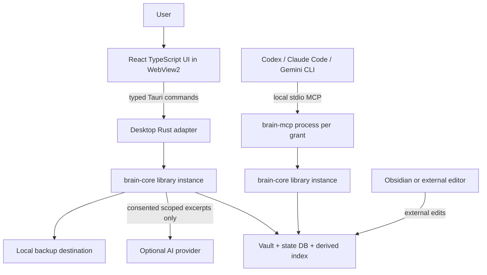
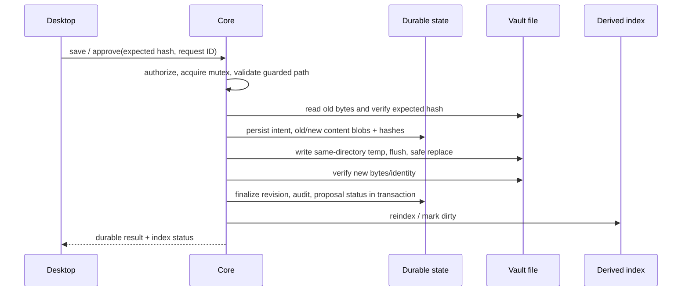

# Personal Brain — System Architecture

| Field | Value |
|---|---|
| Version | 0.1.0 |
| Baseline | PRD.md v0.1.0, 24 November 2026 |
| Status | Proposed technical baseline; owner review required before coding |
| Companion | DATA_SCHEMA.md, MVP_TASKS.md, ../AGENTS.md |

## 1. Architecture goals and constraints

Implement PRD G-01–G-06, FR-001–026 and NFR-001–015 as a modular local-first Windows desktop application. One active vault per desktop session; registry can hold multiple vaults. One shared Rust core is consumed by desktop and MCP binaries; no duplicate implementation of storage/security. No background cloud synchronization, mandatory account, training of model weights, public HTTP listener, Docker or microservices. AI Chat is P1 with explicit release exception if deferred; embeddings are P2. User owns Markdown. Graph is a derived view, never a second source of knowledge. A failure in GPU, provider or MCP must not disable local note management.

The architecture is a design contract, not evidence of working code. Verify exact crate/package versions, supported Windows builds and client configuration against official documentation during PB-006–009; lock versions after successful clean build.

## 2. Context and deployment



Shared library does not mean a shared in-memory singleton: desktop and MCP run separate processes. Both use identical storage and policy contracts. MVP avoids a permanent background service. MCP can run while desktop is closed; proposals persist and are reviewed on next desktop startup. Desktop is the only adapter exposing approve/reject/restore. Local read/search may need index reconciliation even with the desktop closed. Use a bounded per-vault interprocess lock and SQLite transactions (section 7). No remote TCP listener in MVP.

Deployment paths (illustrative, obtained through OS path APIs):

- User-selected vault, e.g. `D:\PersonalBrain\Vault`; no requirement for a prescribed folder layout or administrative privilege.
- Per-user local application data: `PersonalBrain/registry.sqlite`, `vaults/<vault_id>/state.sqlite`, `index.sqlite`, recovery/blobs, settings. Resolve through platform APIs, not hardcoded usernames.
- Desktop and MCP executables from Windows installer; installer exposes MCP executable path and client setup instructions, never silently edits agent config.
- Backup destination chosen by user; cannot be nested in the indexed vault, inside `%LOCALAPPDATA%\PersonalBrain`, or an ancestor directory containing the vault. API credentials via OS-backed credential storage; do not include credentials in backup.
- Windows filesystem is baseline. WSL tools may reach a Windows drive through `/mnt/...`, but direct Linux agent access, cross-runtime locking and watchers need separate qualification. Recommend Windows-native MCP process for MVP; do not promise WSL integration until tested.

## 3. Repository and ownership

```text
personal-brain/
  apps/desktop/                  # frontend package
    src/{app,features,components,lib}/
    src-tauri/                   # command adapters, capabilities, installer
  crates/brain-core/src/
    domain/                      # IDs, types, policies, errors
    vault/                       # resolver, guarded I/O, mutations
    markdown/                    # parse, preserve, resolve links
    index/                       # derived store, FTS, graph query
    state/                       # registry, grants, proposals, journal
    memory/                      # lifecycle, review, revisions
    retrieval/                   # bounded search/context assembly
    backup/                      # snapshot/restore/retention
    ai/                          # optional provider adapters
  crates/brain-mcp/               # stdio transport, tool schemas, auth context
  tests/fixtures/                 # synthetic vaults, golden files
  scripts/                       # repeatable build/test/benchmark scripts
  docs/                          # product, design, schema, task and ADR docs
  AGENTS.md
  Cargo.toml                     # Rust workspace incl. desktop backend
  package.json                   # npm workspace/scripts
  README.md
```

Dependency direction: `domain` has no UI, DB or protocol dependency; storage and parser implement domain ports; use cases compose ports; adapters call use cases. No frontend direct filesystem or database operations. MCP cannot invoke privileged desktop review methods. `brain-core` does not import Tauri or MCP. Frontend graph receives typed graph DTOs; no renderer-specific objects in persistence. Use npm and Cargo lockfiles; keep generated artifacts out of Git. Architecture tests/code review enforce module boundaries.

## 4. Components and interfaces

| Component | Responsibility | Failure behavior |
|---|---|---|
| Registry / Vault service | select root, identity, scoped file enumeration, CRUD | unavailable vault; explicit relink; no auto-create over missing vault |
| Markdown parser | parse without destructive normalization; offsets, links/tags | diagnostics, plain text access; no implicit repair |
| Index service | FTS5, relations, reconciliation, graph snapshots | stale indicator/rebuild; source remains accessible |
| State service | IDs, grants, proposals, revisions, journal, audit | fail closed for AI/mutation if unavailable; read-only recovery mode |
| Memory service | propose/review/commit/restore and provenance | conflict/recovery required; never silent overwrite |
| Retrieval | scoped keyword search, source refs, context budgets | explicit stale/no result/insufficient context |
| Graph UI | clustering, filters, camera, node interaction | list fallback and retained editor access |
| Provider adapter | bounded requests, cancellation, consent, source handling | visible error; no local-feature dependency |
| Backup service | consistent snapshot, verify, restore, retention | incomplete snapshots marked invalid; no in-place restore by default |

### 4.1 Core use-case contracts (language-neutral)

Identifiers and DTOs in DATA_SCHEMA.md. All operations return typed result or stable error code. No arbitrary absolute paths from MCP. Desktop file picker is trusted UI input only for selecting roots, subsequently validated in core.

```text
create_vault(desktop_actor, selected_root, display_name) -> VaultSummary
open_vault(selected_root) -> VaultSummary
export_vault(desktop_actor, vault_id, destination) -> JobId
list_notes(vault_id, filter, page) -> Page<NoteSummary>
read_note(actor, vault_id, note_id) -> NoteSnapshot
create_note(desktop_actor, vault_id, rel_path, body, request_id) -> MutationResult
save_note(desktop_actor, vault_id, note_id, expected_hash, body, request_id) -> MutationResult
preview_move(vault_id, note_id, destination) -> MovePlan
move_note(desktop_actor, vault_id, plan, expected_hash, request_id) -> MutationResult
trash_note(desktop_actor, vault_id, note_id, expected_hash, request_id) -> MutationResult
restore_trashed_note(desktop_actor, vault_id, note_id, request_id) -> MutationResult
set_note_verification(desktop_actor, vault_id, note_id, verification, expected_hash, request_id) -> NoteStatus
set_pinned(desktop_actor, vault_id, note_id, pinned) -> NoteStatus
list_grants(desktop_actor, vault_id) -> Vec<AgentGrant>
create_grant(desktop_actor, vault_id, grant_input) -> AgentGrant
update_grant(desktop_actor, grant_id, grant_patch) -> AgentGrant
revoke_grant(desktop_actor, grant_id) -> AgentGrant
search(actor, vault_id, query, filters, page) -> Page<SearchHit>
get_graph(desktop_actor, vault_id, filters) -> GraphSnapshot
propose_memory(agent_actor, proposal_input, request_id) -> ProposalSummary
review_proposal(desktop_actor, vault_id, proposal_id, proposal_version, decision, edited_body?, verification?, request_id) -> ReviewResult
restore_revision(desktop_actor, vault_id, revision_id, expected_current_hash, request_id) -> MutationResult
rebuild_index(desktop_actor, vault_id) -> JobId
create_backup(desktop_actor, vault_id, destination) -> JobId
restore_backup(desktop_actor, backup_id, destination, plan) -> JobId
```

`ActorContext` is constructed by native adapter from verified grant/desktop session, not supplied by renderer/tool input. It contains principal, permitted vault/folder scopes, permissions and policy version. All use cases validate authorization, input length, scope, current note/hash and result limits. Tauri commands map fixed DTOs to core; generate or validate TS bindings against Rust contract; events carry vault ID, revision/generation and minimal metadata. Never send API secrets to renderer. Long tasks run off UI thread, support progress/cancel and do not interrupt critical commit sections.

### 4.2 Error contract

`{code, message, retryable, operation_id?, safe_details?}`; user-facing explanations separate from internal diagnostics. Codes: `INVALID_INPUT`, `VAULT_UNAVAILABLE`, `ACCESS_DENIED`, `NOTE_NOT_FOUND`, `AMBIGUOUS_LINK`, `CONFLICT`, `BUSY`, `DISK_FULL`, `IO_FAILED`, `PARSE_WARNING`, `INDEX_STALE`, `STATE_UNAVAILABLE`, `RECOVERY_REQUIRED`, `PROVIDER_UNAVAILABLE`, `CONSENT_REQUIRED`, `CANCELLED`, `LIMIT_EXCEEDED`. No absolute file paths or raw note content in MCP errors/logs. Never return success if durable mutation not confirmed. `INDEX_STALE` may accompany successful source commit; schedule reconcile and show indexing state.

## 5. Markdown and identity

A vault may contain Markdown without frontmatter. Opening/indexing never writes files. Imported notes get stable ID mapping in durable `state.sqlite` (not index); new notes may include namespaced frontmatter `personal_brain_id` generated by app. State mapping is backed up. Track relative path + file identity where available + content hash; hash alone not an identity. App-managed move preserves ID. External rename recognized via verified rename pair or unambiguous file identity; if ambiguous, prompt relink and keep missing-note mapping, never merge by similarity. Duplicate embedded IDs are diagnostics, not silently overwritten. Preserve bytes, newline convention and unknown YAML when no change requested. Invalid YAML remains readable; editing metadata requires explicit correction. Details in DATA_SCHEMA.

Resolution order for wikilinks: explicit vault-relative path or source-relative qualified path as defined by syntax; then unique normalized basename/alias (aliases only if no basename hit). Multiple candidates -> ambiguous. Markdown relative links resolve from source directory. Ignore links in fenced code and inline code. Resolve headings/aliases separately; unsupported embeds remain intact, never execute. No automatic mass rewrite. App rename/move default shows affected backlinks and leaves link text unless user selects controlled update; MVP may defer multi-note rewrite (show clear manual repair instructions). Never claim full Obsidian plugin compatibility.

## 6. Index and retrieval flow

1. Scan eligible regular `.md` files within authorized root, skip `.obsidian`, `.git`, app artifacts, reparse points and temp files. Attachments listed but contents not parsed/indexed in MVP.
2. Read guarded snapshot, compute SHA-256 of original bytes; resolve stable ID in state. Parse content/metadata; persist derived note/link/tag/FTS rows transactionally in index.
3. Resolve links in second pass after inventory; refresh affected target/source relations after rename/delete. Mark unresolved targets rather than invent edges. Track index generation and source hashes.
4. Watcher (native Windows events) signals dirty paths; debounce/coalesce (initial 200–500 ms), handle overflow by full reconcile. Reconcile on startup, explicit refresh, watcher loss and before MCP retrieval when desktop absent. Index lag is observable; queries return as-of generation.
5. Search via parameterized FTS5 query generated from literal tokens (advanced syntax not enabled by default); combine title/body/tag match and deterministic tie-break by ID. Filter scope before ranking/excerpts. Revalidate current access and note hashes on read/results; omit stale/deleted/unreadable hits or refresh them. Pagination bounded; no unauthorized hit counts/snippets/backlinks.
6. Context assembler prioritizes relevant project, explicit links, verified/current metadata; clips snippets, deduplicates, includes hash/path/line ranges and flags outdated or unverified notes. No automatic access escalation. P2 embeddings are derived, versioned by provider/model/chunker; local by default where feasible, cloud only with consent; compare baseline and hybrid retrieval on frozen fixture questions.

Graph DTO uses `note_id` nodes and resolved explicit links; graph revision = index generation. Suggested edges kept separate and filtered by default. Frontend retains stable selection, batches changes, cancels obsolete fetches, pauses simulation when idle/hidden, uses label LOD and reduced motion. P0 1,000 nodes/2,500 edges tested; fallback list is required (FR-013). No per-frame native calls or database writes.

## 7. Concurrency, durability, and recovery

### 7.1 Coordination

One per-vault OS file lock (`LockFileEx` on `%LOCALAPPDATA%\PersonalBrain\vaults\<vault_id>\vault.lock`, per `ADR-0001`) derived from registry vault ID; lock path/identity not arbitrary input. All cooperating writers and backup snapshot use it, including state mutation, mapping, index generation commits and proposal review. Lock order: vault lock → short state transaction → index generation commit (never hold both DB transactions while doing provider calls). Timeouts return `BUSY`; abandoned lock triggers journal recovery and reconcile before accepting writes. SQLite WAL, foreign keys, bounded busy timeout, migration under exclusive coordination. UI calls do not block rendering; multiple readers use snapshots against generation-named `index-<gen>.sqlite` files. Desktop and MCP must share same OS user registry and vault ID; avoid duplicate registrations using canonical root identity. Index data can lag; state is authoritative for governance.

External editors do not honor this lock. Hash compare on open/commit, guarded Windows handles and sharing/replace policy to reduce TOCTOU; recheck identity/content immediately before replacement and verify result. Test actual NTFS behavior (including competing editors, junction swaps, and replacement handles) before declaring AC-016. No guarantee against arbitrary uncooperative processes writing outside the app; if safe replacement/validation cannot be established, return conflict, preserve attempted edit as recovery copy, and do not overwrite. Do not support network/sync-drive concurrency as qualified MVP unless tested; warn about unsupported locations. Review platform-specific file replace and flush semantics during PB-010/PB-013.

### 7.2 File mutation journal (single note transaction)



Prepare includes a durable preimage, postimage and unique operation/request ID; only after durable intent perform filesystem change. Create uses exclusive create/no overwrite; move uses no-overwrite destination and journal; trash stores recoverable bytes before removal. Temp files excluded from scanner. Use Windows-safe replacement primitive with appropriate write-through/flush and recovery; do not call rename-overwrite blindly. On restart compare actual source/destination hashes with recorded pre/post state: if pre-state intact, abort or require retry; if post-state intact, finalize exactly once; if neither, preserve all versions, enter `RECOVERY_REQUIRED`, surface review. Never repeat approval blindly. Index failure does not roll back confirmed note; dirty queue and reconciliation restore consistency. Filesystem and SQL are not a single atomic transaction. No automatic multi-file transaction in MVP; defer auto backlink rewrites or perform explicit per-note planned edits with visible partial outcomes.

### 7.3 Backup/restore

Before risky migration or on user request, capture vault notes/attachments, state DB consistent snapshot (SQLite backup API or equivalent verified method), referenced blobs, registry/settings subset, manifest with hashes and versions. Index optional; omit and rebuild by default. Capture under cooperating writer lock and refuse `create_backup` while `prepared` or `recovery_required` journal rows exist; external edits can race, therefore compare inventory/hashes before and after and retry/fail if inconsistent. Refuse unsafe paths (including destinations inside vault, inside `%LOCALAPPDATA%\PersonalBrain`, or vault ancestors), missing blobs, invalid manifest; stage to temp and publish complete marker only after verification. Restore default to new folder/registry; restore-alongside generates a new `vault_id` (recording old→new mapping), merges a new `registry.sqlite` entry, verifies before switching active vault, disables restored agent grants pending explicit re-authorization, excludes credentials. Preserve original until explicit confirmation. Retention policy in DATA_SCHEMA; clear delete/backup implications. State corruption requires restore/read-only mode; never replace state with blank DB silently.

## 8. MCP and trust boundaries

Transport: local stdio, one process per configured grant; JSON-RPC/MCP handled by maintained Rust SDK (candidate `rmcp`, verify versions and interoperability during PB-022). Protocol stdout reserved for MCP; redacted diagnostics stderr. Launch binds grant ID from local protected configuration or command-line identifier (nonsecret ID), not arbitrary caller-supplied actor. Registry default deny; validate grant active, scope and capabilities on every tool invocation and immediately before results/commit. No grant creation, approval, arbitrary file access, shell, network, or raw SQL tools. Revoke blocks subsequent requests; in-flight results check again before returning. Agent attribution means configured integration identity, not cryptographic model identity. Same OS account can edit files directly or tamper with local state; MCP permissions only protect the application's interface, not malicious processes with equivalent filesystem rights. Users should sandbox coding agents separately if needed.

| Tool | Inputs | Output | Permission |
|---|---|---|---|
| list_vaults | none | scoped vault ID/name only | read |
| search_memory | vault_id, query, folder/tag filters, limit, cursor | bounded hits + sources + generation | read |
| read_note | vault_id, note_id, optional start_line/max_lines | excerpt, hash, source, verification | read |
| get_project_context | vault_id, project_rel_path, query?, max_chars | bounded source-backed context | read |
| get_related_notes | vault_id, note_id, limit | scoped explicit links/backlinks | read |
| propose_memory | vault_id, action, target/base_hash or new_rel_path, proposed_text, reason, sources, request_id | proposal ID/status only | propose + read target scope |
| list_pending_changes | vault_id, cursor | caller's own proposal metadata (filtered by current scope) | propose |
| get_memory_proposal | vault_id, proposal_id | caller-owned proposal details, still scoped | propose |

Read default limit 20 max 50 hits, max 8 KiB per excerpt, context max 32 KiB, proposed text max 64 KiB (configurable hard ceilings by design review); validate UTF-8 and schema, paginate, reject oversized input. For `propose_memory(create)`, `new_rel_path` must fall inside `grant_scopes`, use `.md` extension, and exclude `.obsidian`/`.git`/app artifacts; out-of-scope source/target `note_id`s must return an error indistinguishable from `NOTE_NOT_FOUND`. Reject proposals setting `personal_brain_id`, `personal_brain.verification`, or `verified_at` (`INVALID_INPUT`). No absolute path accepted; no full vault export tool. Source includes note_id, relative path, hash, line range; external source claim is labeled agent-asserted. Text is untrusted data: escape/sanitize renderer, separate tool outputs from trusted instructions, no execution. Even correctly retrieved notes can contain injection; client may still follow them, so no privileged mutation tools. External AI clients can transfer tool results to their own provider; disclose before granting access, app cannot control downstream retention.

## 9. AI Chat and privacy (phase 7)

Provider interface: `generate(request, cancel_token) -> stream events` with allowed model, scoped context, token/byte budget, timeouts; adapter can use official APIs, not assume existing subscription covers API cost. Credential access only native layer; provider consent per provider/vault/scope, preview included notes, no background upload, no credentials in logs/notes. Citation references validated against supplied source IDs/hashes; unknown references marked unsupported. Model text cannot invoke approval. Offline error isolates chat. Do not implement hidden conversation scraping. Optional user-triggered capture workflow produces proposal with source, no direct write. Semantic provider selection after baseline evaluation, vector artifacts removable. Local inference not required. Do not auto-collect personal info or full chat logs.

## 10. Security design and verification

- Filesystem: canonical root, reject absolute/UNC/device paths in relative input, `..`, alternate data streams, reserved names, trailing dots/spaces, case-collision, symlink/junction/reparse traversal, hardlinked notes for mutation/agent read unless explicitly qualified. Validate using Windows handle identity/final path, not string prefix alone; deny escapes at every hop and race tests. Fail closed on validation error. Restrict regular `.md` read for MCP; attachments not included automatically.
- Tauri: minimal capabilities per window, no generic FS/shell/exec commands, restrictive CSP, no remote page in privileged window. Sanitize Markdown HTML and links, block scripts/iframes/remote images/`file://`/UNC (`\\`)/drive-absolute links by default, serve local attachments only via a core-served scoped protocol validating vault-relative paths (no broad Tauri `assetProtocol`), external URL opens only after scheme validation/user action. No model-supplied command execution.
- Data: app-data ACL for current user; no promise of encryption at rest. OS disk encryption recommended if required. Redact logs, no raw queries/notes/secrets by default. Limit request size, CPU, concurrency and retries; timeout/cancel expensive work.
- Recovery: test corrupted index vs corrupted state independently, power/crash injection at journal transitions, full disk, access denied, concurrent processes, external edits, backup/restore, symlink/junction swap, revoked grant, fake actor and stale proposal. All critical failures block release.
- Dependency management: pin lockfiles; review licenses, security advisories, maintenance status before adoption; record decisions. No telemetry by default.

## 11. Test and performance architecture

Unit (pure parser, resolver, state machine, authorization, ranking); integration (SQLite and temp vault, two real processes, journal failpoints, watcher); adapter contract (Tauri IPC and MCP schemas); frontend component and end-to-end Windows (real WebView2, keyboard, conflict UI, graph fallback); clean installer VM. Synthetic fixtures only. Benchmark on documented baseline CPU/RAM/GPU/OS/disk: keyword warmed P95 <300 ms at 1,000 notes (>=100 repeated representative queries; measure UI-to-core roundtrip separately); graph 1,000/2,500 target median >=30 FPS and P95 interaction latency <=150 ms during documented orbit/selection trace, no stalls >500 ms after warm-up, fallback when unsupported. These are proposed measurable thresholds, confirm PB-009 before testing, not achieved metrics. Include cold start and peak RSS as observations. No arbitrary metric relaxation after failed test without ADR and owner sign-off.

## 12. Architecture decisions (PRD D-01–D-12)

| ID | Proposed resolution |
|---|---|
| D-01 | Registry multiple vaults, one active desktop vault; explicit scopes for MCP |
| D-02 | Durable ID mapping; optional embedded ID for app-created notes; no mass rewrite |
| D-03 | Preview affected links; default no rewrite; user repair; batch rewrite deferred |
| D-04 | Separate state and derived index DB, backup state/blobs |
| D-05 | Explicit retention; defaults in schema; no misleading permanent deletion |
| D-06 | Default deny, grant read separately from propose; no approval tool |
| D-07 | AI Chat P1, explicit release exception if deferred; P0 gates unchanged |
| D-08 | FTS baseline first; no mandatory vector store or embedding model |
| D-09 | Set measured baseline at foundation; proposed graph criteria section 11 |
| D-10 | Manual Windows installer initially; auto-update deferred |
| D-11 | One proposal/one target approval in MVP; batch approval deferred |
| D-12 | Standalone stdio MCP process using same core, no desktop dependency |

## 13. Readiness and references

All 12 decisions must be reviewed with PRD; confirm Windows support and toolchain, validate safe file I/O prototype and two-process coordination before broad implementation. See DATA_SCHEMA for constraints and MVP_TASKS for traceability. Reference entry points for dependency verification (not a claim of live version compatibility): https://v2.tauri.app/ ; https://www.sqlite.org/fts5.html ; https://modelcontextprotocol.io/ ; https://github.com/modelcontextprotocol/rust-sdk ; https://github.com/vasturiano/3d-force-graph ; https://help.obsidian.md/ ; https://codemirror.net/ .
